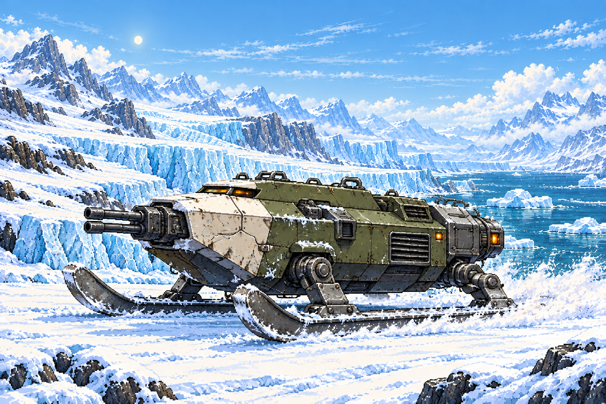
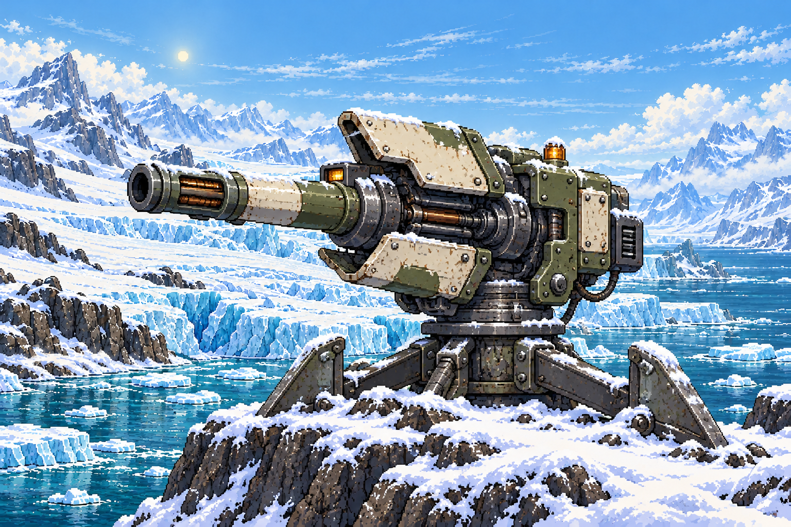
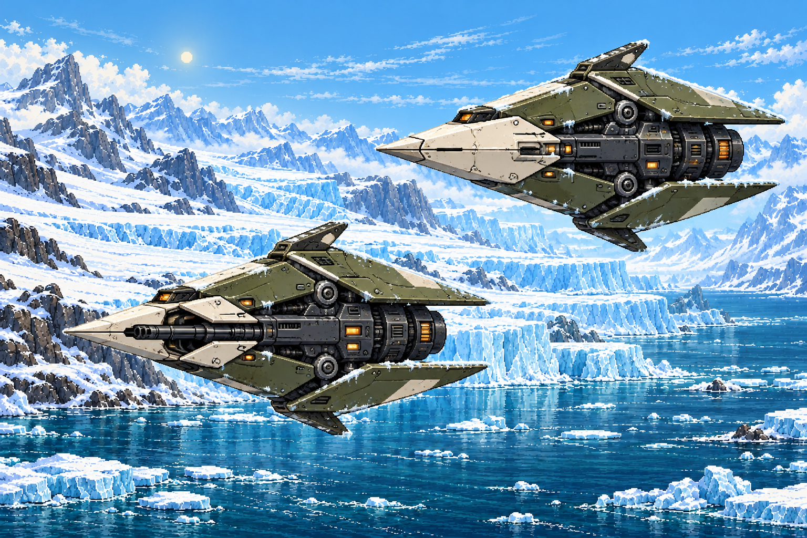
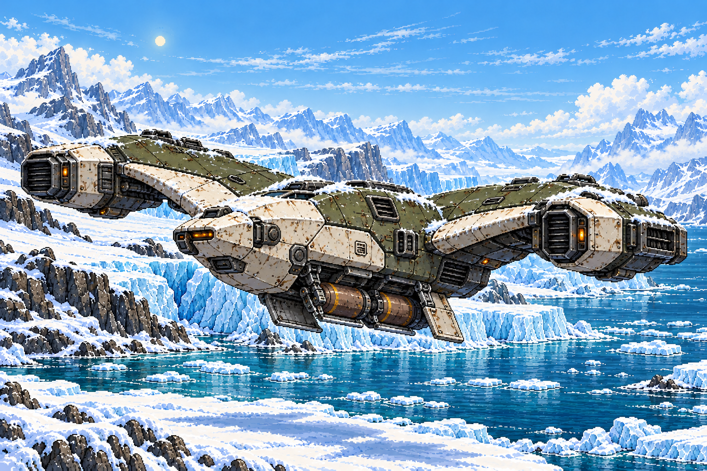
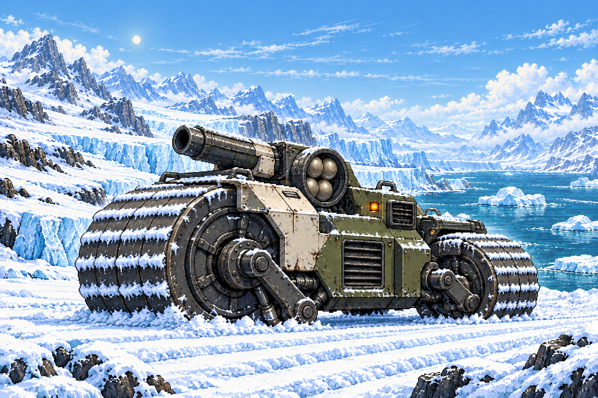
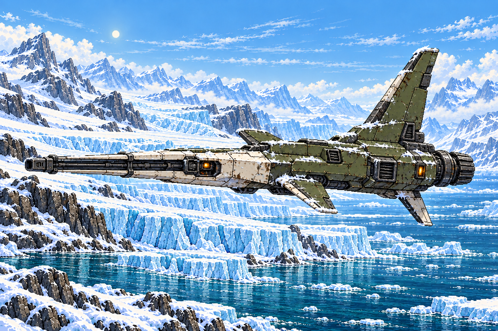
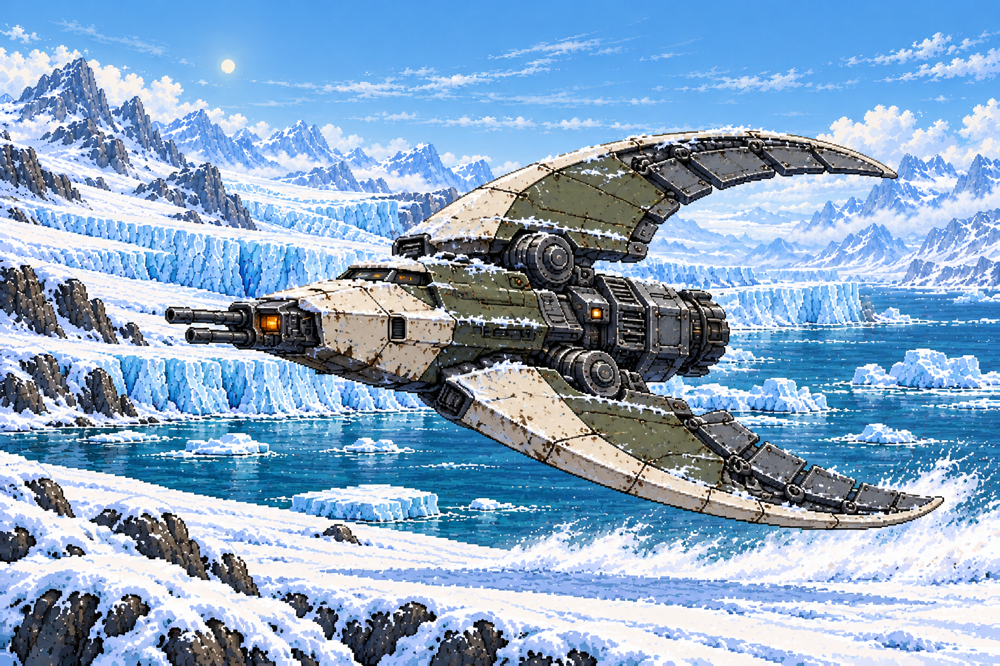
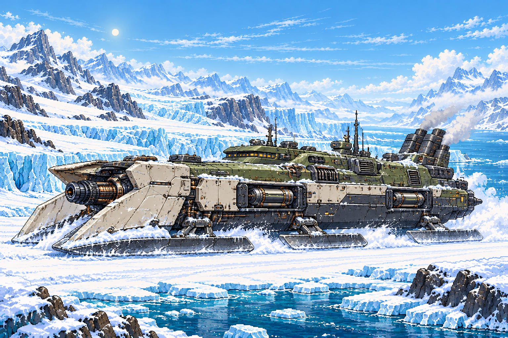

# Glacier Coast — enemy and boss pictures

The location is approved. These are proposed designs for your next review:
seven regular enemy types and one boss. They share worn olive-and-cream armor,
dark mechanical undersides, frost, and small amber warning lamps.

The pictures show close-up concepts in the approved daylight glacier world.
They are not gameplay screenshots or finished sprites. Enemy designs, attack
rules, counts, health, and difficulty remain open. Nothing has been added to
the demo or campaign.

The user likes the four new designs. Preserve that visual direction. The
next review concerns the playable combat plan and behavior, not another
redesign of those pictures.

The user requested more enemies after the first three concepts. Crest Bomber,
Snow Roller, Needle Wing, and Wake Hunter expand the roster to seven types.
Twin Darts count as one type, with two craft. These are type counts, not the
number of enemies that would appear in a full level.

The [revised combat-preview proposal](next-stage.md) has two selectable
30-second flights covering all seven regular types. It awaits implementation
approval. The boss fight would follow in a separately planned stage.

## Shelf Skiff

A low gunboat sliding on two broad ice runners. Its short front guns and
sweeping hull make it look fast. Proposed role: brakes on the snow, warns,
then fires a spread before moving again.

## Anchor Gun

A compact cannon with broad anchor braces gripping a low rock ledge. Its
barrel and opening armor must stay exposed so the player can shoot back.
Proposed role: a stationary heavy shot with a clear warning.

## Twin Darts

Two diamond-shaped flying drones with folding armor. The picture shows the
same design with its gun shutters open and closed. Proposed role: approach
in separate lanes and take turns firing. They count as one enemy type.

## Crest Bomber — new

A broad flying bomber with an arched wing, two engine housings, and an opening
belly bay. Proposed role: show a clear warning and drop bombs toward marked
positions. The bombs and their landing warnings must remain visible.

## Snow Roller — new

A squat ground machine with large ribbed roller drums. Proposed role: launch
shootable rolling charges that pressure the lower flying lanes. Each charge
must warn before bursting and expire quickly. Its gun stays above its front
drum so the ordinary weapon can reach it.

## Needle Wing — new

A slender aircraft with a long forward gun and a tall rear fin. Proposed
role: visibly line up its aim, lock the direction, then fire one fast shot.
There must be time to dodge after the aim locks; no instant, unannounced hit.

## Wake Hunter — new

A compact interceptor with curved, swept-back wings and air brakes. Proposed
role: bank, warn, then commit to a fast diving pass before climbing away.
The committed path must be avoidable, stay above the ground, and never
silently track every movement during the dash.

## Breakwater — boss

A large, low armored vessel skating on three ice runners. Its wedge bow,
side launch doors, and compact rear exhaust tower give it a naval shape.
It has no walking legs, tank tracks, or saw ring.

The proposed weak point sits inside the front gun chamber, visible when the
bow armor opens. Sliding and braking would define the fight. The final
attacks and three-phase behavior need their own review after the look is
approved.

## Production record

Generated as original 2D concept illustrations through OpenAI ImageGen, using
`demos/glacier-coast/assets/glacier-world.png` as the approved setting reference.
Original requests and hashes are in `requests.json` and `provenance.json`;
the four additions use `requests-expanded.json` and `provenance-expanded.json`.
The additions also reference Shelf Skiff for faction material and art consistency.
These review sources have not been converted into the
game's sprite format or admitted as runtime assets. No third-party asset
library or separately billed provider was used.
