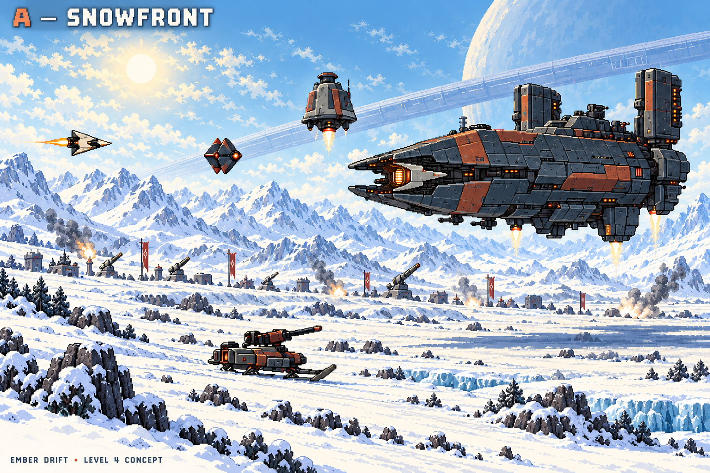
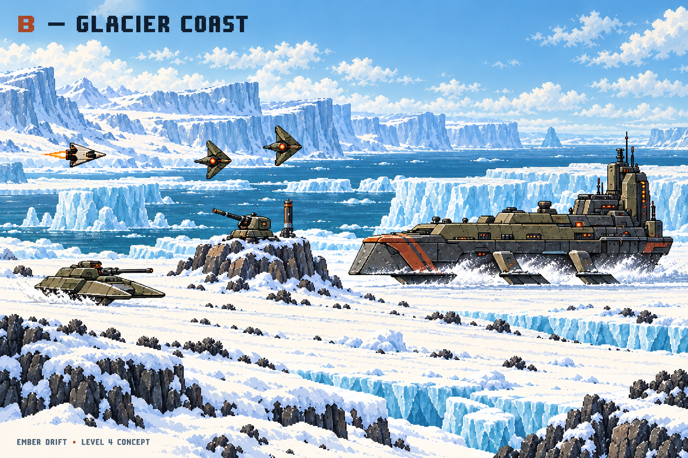
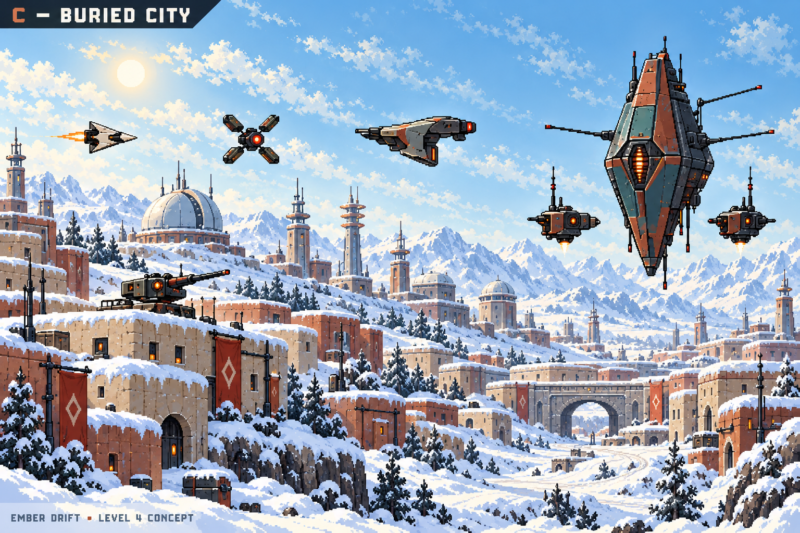

# Ember Drift — three Level 4 concept images

**Selected direction: B — Glacier Coast.** A and C remain comparison images.
The current game remains unchanged; Level 4 has not been implemented.

## A — Snowfront

Open daylight snowfields, ground gun sleds, folding guards, and bombers.
**Hailbreaker** is the large flying command cruiser.

## B — Glacier Coast — selected

Snow-covered coastal shelves, ice cliffs, sea, gun skiffs, and paired drones.
**Breakwater** slides over the ice on broad runners.

## C — Buried City

A snowbound colony with observatories, rooftop guns, and patrol drones.
**Bellwether** is the tall flying command craft with two escort guns.

The user chose B after reviewing all three images. The planet's final name,
enemy behavior, boss rules, and implementation remain proposals for review.

[Read the full concept review](level-4-review.md).
