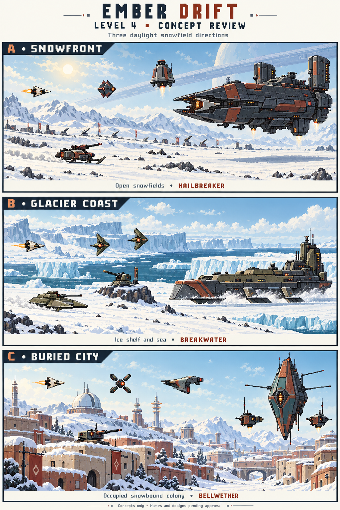

# Ember Drift — Level 4 concept review

**Status: B — Glacier Coast location approved after demo revision 2. Enemy and boss pictures are the next review; the full level remains unimplemented.**

Prepared only for `FaisalKhalil495/retro-space-shooter-codex-parallel`.
`retro-space-shooter` and `retro-space-shooter-codex` are outside the scope of
this work. The existing game remains at v0.29.0.

[View the three larger individual concept images](level-4-images.md).

The picture shows possible scenes and silhouettes, not screenshots of a new
level or finished game assets. All names below are working names.

## The shared idea

You descend from Frostring's ring to the frozen planet below. The invaders
have established a foothold; you fly through a daylight battle to drive them
back. Open snowy ground and a visible sky make the arrival feel different
from Frostring's dark space and Rust Moon's red canyon.

All directions retain the game's original pixel-art style, restrained colors,
dark enemy outlines, and warm warning colors. The final pictures would use
the existing double-detail approach and game scale. Background fighting would
stay dim and decorative so players can distinguish it from real threats.
Snow, smoke, buildings, and effects must never hide enemy shots or pickups.

## A — Snowfront: an open battlefield

**Look:** a pale winter sun over rolling ivory snowfields, shallow trenches,
distant mountains, and small signs of defenders resisting the invasion.
Enemy machines have charcoal armor and worn rust-red panels. Long blue-grey
shadows give the snow depth without turning the scene dark.

**Feeling:** a fast, exposed battle in open country. You see trouble coming
and weave between ground fire and aircraft above it.

Suggested enemies:

- **Recoil Sled:** a squat gun on two short skis. It brakes, flashes its
  muzzle, then fires a short aimed burst. It stays on the ground and shoots
  only when the player can shoot back.
- **Kite Guard:** a compact flying machine with folding hexagonal armor. It
  banks into position, opens its front plates, and fires before retreating.
- **Bell Bomber:** an upright, bell-shaped drone. Its underside opens before
  a bomb drop; a ground marker shows where the blast will land.

**Boss — Hailbreaker:** an airborne command cruiser with a forked armored
nose, two tall engine pods, and a stepped metal spine. It rises and dives over
the snow, casting a shadow below. Its shape and movement distinguish it from
the Siege Crawler's legs and ground attacks, and from the Warden's saw ring.

Its forward cooling vent opens after heavy attacks: dodge the attack, then
move into position to shoot the exposed vent. The opening faces the player
and remains reachable with the ordinary gun. Concept attacks are cannon
bursts, staggered bomb drops, escort drones, a sweeping exhaust blast, and a
warned charge. Three phases would strip its forward armor, expose the engine
housing, then leave the damaged cruiser making shorter, more urgent passes.
Exact timings, health, and damage would be planned after the direction is
approved.

**Main strength:** it most directly delivers the daylight ground-battle idea
already recorded in the project documents. Dark enemies stand out clearly.

**Watch out for:** too much snow spray or background fighting. Keep those
effects small and below the action.

## B — Glacier Coast: the invasion along an ice shelf — selected

**Look:** a broad snow-covered coast, distant stepped cliffs, and dark teal
sea beyond the ice. Enemy machines use weathered olive and bone-colored
armor, with dark undersides. The sky stays bright and cold.

**Feeling:** a windswept coastal advance, with long open stretches and a
strong sense of the planet's size.

Suggested enemies:

- **Shelf Skiff:** a low gunboat on two broad runners. It slides across the
  snow, brakes, and fires a warned spread before moving on.
- **Anchor Gun:** a small exposed cannon braced on a low rock above the snow.
  It opens to fire a heavy shot; terrain must never conceal it from the player.
- **Twin Darts:** two diamond-shaped drones that approach in a loose pair
  and take turns firing. Their paths remain separate and easy to read.

**Boss — Breakwater:** an armored vessel that skates over the ice on three
smooth runners. A wedge-shaped bow pushes through snow while a compact rear
exhaust tower leans into each turn. It has no legs or tank tracks.

Its forward gun chamber opens while it brakes for a heavy volley. Possible
attacks are broad cannon spreads, skipped explosive shells, drone launches,
snow plow charges, and marked ice-fragment bursts. Three phases would break
the bow armor, expose the side launchers, then crack the main gun housing.
Its threat comes from sliding speed and changing firing angles.

**Main strength:** the sea and ice shelf make this a memorable new landscape.

**Watch out for:** becoming another ground-fortress fight. Breakwater would
need quick sliding movement and a low naval silhouette. Ocean openings in the
concept are background scenery; water hazards are not part of this proposal.

## C — Buried City: taking back a snowbound colony

**Look:** snow-covered streets, partly buried cream and terracotta buildings,
round observatory roofs, and weather towers against a pale daytime sky.
Invader machines have dark metal bodies with faded teal panels. Their shapes
contrast with the colony's low, rounded buildings.

**Feeling:** a more personal liberation. This is a place people lived in,
now occupied by the enemy.

Suggested enemies:

- **Relay Drone:** a small four-arm machine that unfolds before firing a
  patterned volley. The unfolding is its warning.
- **Roof Gun:** a squat gun pod on a low, reachable rooftop. It flashes a
  sight line before firing; no taller building may block the player's return
  shot.
- **Snowblade Patrol:** a narrow glider with a shovel-shaped nose. It makes
  short passes and fires only when its nose faces the player.

**Boss — Bellwether:** a tall diamond-shaped command craft with four thin
antenna arms and two separate escort gun pods. It floats freely above the
roofs, moving across several heights rather than sitting on a tower.

Its front radiator opens after a charged attack. Possible attacks are aimed
energy pulses, alternating escort shots, marked bomb drops, released drones,
and a warned diving pass. Three phases would lose outer armor, shed antenna
arms, then expose the central hull. It is a machine and uses explosions, not
blood.

**Main strength:** the colony gives the defender story a visible human stake.

**Watch out for:** busy architecture and too many tiny details. Keep rooftops
low, scenery faded, and the foreground flying space open.

## Selected direction — B, Glacier Coast

The user chose B after reviewing all three individual images. Preserve its
daylight coast, snow-covered shelves, distant blue cliffs, dark teal sea, and
olive-and-cream invader machines. A and C remain comparison alternatives.
The planet's final name and detailed enemy and boss rules remain open.

## Completed first development stage — coast scenery demo

The user approved this stage. The separate scene is at `demos/glacier-coast/`,
using the existing ship and touch controls, at the real game scale. It stops
after 30 seconds and offers replay. It pauses on interruption or portrait
orientation. See [demo instructions](../../demos/glacier-coast/README.md).

- Show snowy foreground ground, distant ice cliffs, sea beyond the playable
  shelf, and a clear daytime sky. Keep the foreground shelf continuous;
  ocean gaps are scenery, not new hazards.
- Keep the ship, shots, and warning colors easy to see. Preserve the exact
  existing hero, engine flame, and bullet artwork and firing behavior.
- Keep the scene separate from the normal level list and campaign. Add no
  new enemies, boss, pickups, music, or save-data changes in this step.
- Check it at the Android and iPhone screen sizes and safe areas. Confirm
  movement and firing work, the scenery scrolls smoothly, and scripts have
  no errors. Run the existing smoke and three-level playthrough checks to
  verify the existing game still works.

**Revision 2:** the user rejected the first demo's simplified ice blocks and
requested more detail. The coast now depicts a glacier descending through
layered mountains into a fjord, with exposed rock, crevasses, irregular shelves,
floating ice, reflections, and moving water shimmer. It pans slowly across this
world while the snowy foreground moves faster. The user approved this location.

All 35 demo checks, 49 existing smoke checks, and 35 seeded playthrough checks
passed. The user then requested pictures of the enemies, including the boss.
See [enemy and boss visual review](level-4-enemies/review.md). Enemy waves and
the Breakwater fight remain unimplemented. Location approval does not approve
every proposed name, attack, number, or future development stage.

The user subsequently requested more enemy variety. The visual roster now has
seven regular types plus Breakwater: the first three and the added Crest
Bomber, Snow Roller, Needle Wing, and Wake Hunter. Their pictures and proposed
roles are in the linked review. Revisit the earlier three-enemy combat-preview
plan after reviewing this larger set.

Any eventual boss must retain the established entrance, name card, roar,
unique music, three phases, five warned attacks, moving weak point, speech
only during pauses, alternating supplies, and quiet stage bonuses. New music
would be reviewed separately. Existing cargo pods remain recognizable.

This demo stage changes no campaign gameplay, graphics used by the campaign, controls, audio,
saving, menus, imports, version labels, or shipped assets. Level 4 is not
registered in the game. No game release or pull request is part of this review.
